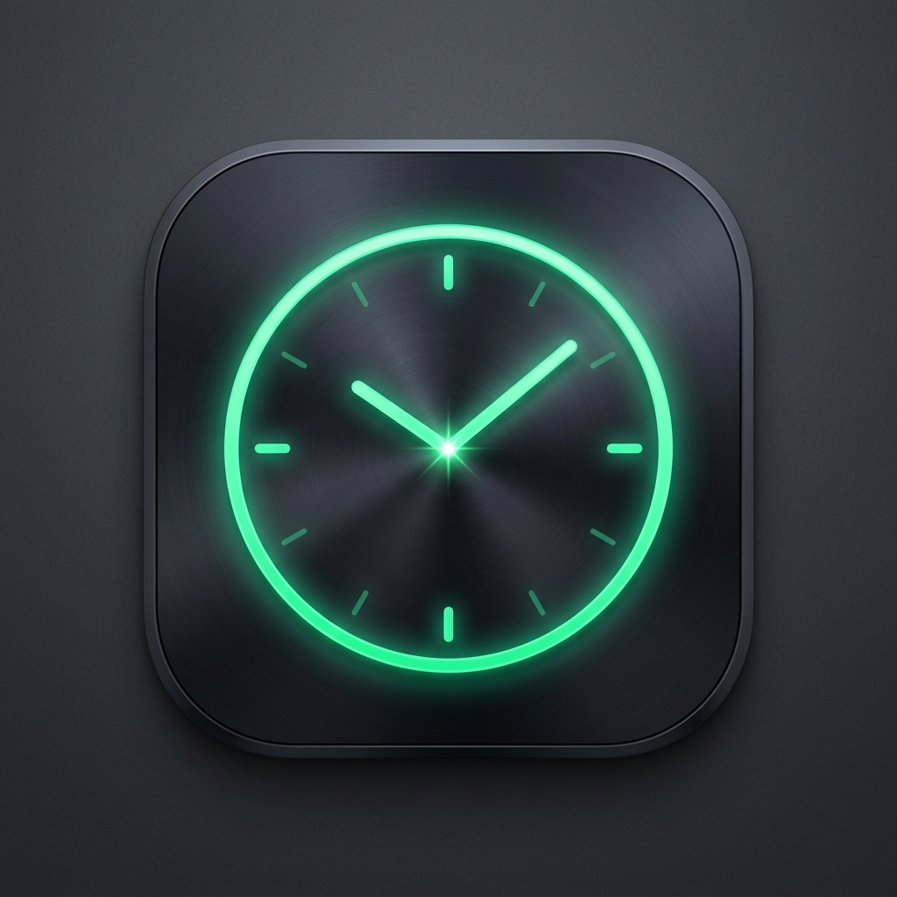

<div align="center">



# ⚡ Mi Turno
### Control Inteligente de Horas Laborales y Ganancias en Tiempo Real

[](https://github.com/NahuPani/work_hours_tracker/actions/workflows/android-ci.yml)


-F9AB00?style=flat-square&logo=sqlite&logoColor=black)


Una aplicación nativa para Android construida con **Kotlin**, **Jetpack Compose** y **Material 3**. Diseñada para trabajadores por hora, contratistas y freelancers que buscan registrar con precisión sus jornadas, turnos partidos o nocturnos, y ver proyectados sus ingresos al instante.

<br />

<p align="center">
  <a href="https://github.com/NahuPani/work_hours_tracker/raw/main/release/work_hours_tracker_latest.apk">
    
  </a>
</p>

</div>

---

## 🌟 Características Principales

### 📱 1. Widget de Pantalla de Inicio (Estilo Fintech Emerald)
- Muestra en tiempo real tus **ganancias acumuladas** y las **horas trabajadas** en la semana sin necesidad de abrir la app.
- Acceso directo con un solo toque (`+ Registrar Turno`) que lanza la aplicación inmediatamente.
- Sincronización automática de fondo cada vez que registras o modificas una jornada.
- Estética cuidada con diseño oscuro, cápsulas de información y gradiente esmeralda.

### ⚡ 2. Tarjeta Fintech & Contador Animado
- **Fintech Card con Gradiente Profundo**: Resumen instantáneo de tus ganancias de *Hoy*, *Esta Semana* y *Este Mes*.
- **Contador Dinámico (`AnimatedMoneyText`)**: Animación estilo ticker bancario que rueda suavemente al actualizarse el monto.
- **Insignia de Día Récord (`🔥`)**: Reconoce automáticamente el día con mayor recaudación de la semana.

### 📄 3. Exportación a PDF Oficial y Planillas CSV
- **Reporte PDF Formal**: Genera en un toque un comprobante profesional con membrete, tabla detallada de fechas, horarios, horas estándar, horas extras y monto total a liquidar.
- **Exportación CSV (Excel)**: Compatible con cualquier software de hojas de cálculo para control contable.
- **Compartir por WhatsApp**: Envía un resumen claro y formateado directamente a tu empleador o cliente.

### 📈 4. Comparativa Semana contra Semana
- Indicador inteligente en la tarjeta principal que compara el rendimiento con respecto a la semana previa (ej: `▲ +12% vs semana anterior`).
- Visualización de tendencia de ingresos y horas totales dedicadas.

### ⏱️ 5. Turnos Nocturnos y Horas Extras Inteligentes
- **Turnos nocturnos**: Soporte nativo para jornadas que cruzan la medianoche (ej: de 22:00 a 06:00).
- **Turnos partidos acumulados**: Si trabajas mañana y tarde el mismo día, el sistema suma las horas de ambas jornadas antes de disparar el recargo de horas extras.
- Multiplicador de recargo configurable (ej: 1.5x, 2.0x) con umbral de jornada estándar a medida.
- **Jornadas limpias**: Sin deducciones automáticas de descanso, adaptado a convenios laborales donde la pausa es remunerada.

### 🗓️ 6. Ciclos Laborales Personalizables
- Configura el día de corte de tu liquidación semanal (por ejemplo, de **Miércoles a Martes**, **Lunes a Domingo**, etc.).
- Gráfico de barras interactivo de 7 días que refleja exactamente el ciclo elegido.

### 🔒 7. Privacidad Total & 100% Offline
- Base de datos local **Room (SQLite)** de alta velocidad.
- Cero servidores, cero recolección de datos y cero publicidad. Tus horarios y finanzas permanecen exclusivamente en tu dispositivo.

### 💾 8. Copia de Seguridad Inteligente
- Exportación e importación segura en formato **JSON**.
- Algoritmo de restauración con deduplicación: fusiona nuevos turnos sin duplicar los registros existentes.

### 🔄 9. Actualizador Automático Integrado
- Detección automática de nuevas versiones lanzadas en este repositorio de GitHub con descarga directa del APK.

---

## 🛠️ Stack Tecnológico & Arquitectura

El proyecto sigue los lineamientos modernos de arquitectura recomendados por Google (**MVVM + Unidirectional Data Flow**):

| Componente | Tecnología |
| :--- | :--- |
| **Lenguaje** | [Kotlin 1.9.24](https://kotlinlang.org/) |
| **Interfaz (UI)** | [Jetpack Compose](https://developer.android.com/jetpack/compose) + [Material 3](https://m3.material.io/) |
| **Patrón Arquitectónico** | Model-View-ViewModel (MVVM) con `StateFlow` reactivo |
| **Base de Datos** | [Room Database](https://developer.android.com/training/data-storage/room) v2 (SQLite) con KSP |
| **Concurrencia** | Kotlin Coroutines (`Dispatchers.IO` / `Dispatchers.Main`) |
| **Navegación** | Jetpack Navigation Compose |
| **Widgets** | Android AppWidget Provider + `RemoteViews` |
| **Generación de Documentos** | Android Native `PdfDocument` API + Android `FileProvider` |
| **CI/CD** | GitHub Actions (Compilación y distribución automatizada) |

---

## 🚀 Cómo Compilar el Proyecto

### Requisitos:
- **Android Studio** (Koala / Jellyfish / Iguana o más reciente).
- **JDK 17** o **JDK 21** (incluido en Android Studio).
- Dispositivo Android físico o Emulador con Android 8.0 (API 24) o superior.

### Pasos:
1. Clona este repositorio:
   ```bash
   git clone https://github.com/NahuPani/work_hours_tracker.git
   ```
2. Abre la carpeta en **Android Studio**.
3. Deja que Gradle sincronice las dependencias del proyecto.
4. Conecta tu teléfono por USB con la *Depuración por USB* activada.
5. Presiona el botón **Run** ▶️ (`Shift + F10`) en Android Studio.

---

## 📦 Instalación Rápida (Sin Android Studio)

Si solo quieres usar la aplicación en tu teléfono:
1. Ve a la carpeta [`release/`](release/) de este repositorio o toca el botón de descarga superior.
2. Descarga el archivo [`work_hours_tracker_latest.apk`](https://github.com/NahuPani/work_hours_tracker/raw/main/release/work_hours_tracker_latest.apk).
3. Ábrelo en tu teléfono Android y pulsa **Instalar**.

---

## 📄 Licencia

Este proyecto está bajo la Licencia **MIT**. Consulta el archivo [LICENSE](LICENSE) para más detalles.

---

<div align="center">
Desarrollado con ❤️ por <a href="https://github.com/NahuPani">Nahuel Panigo</a>
</div>
